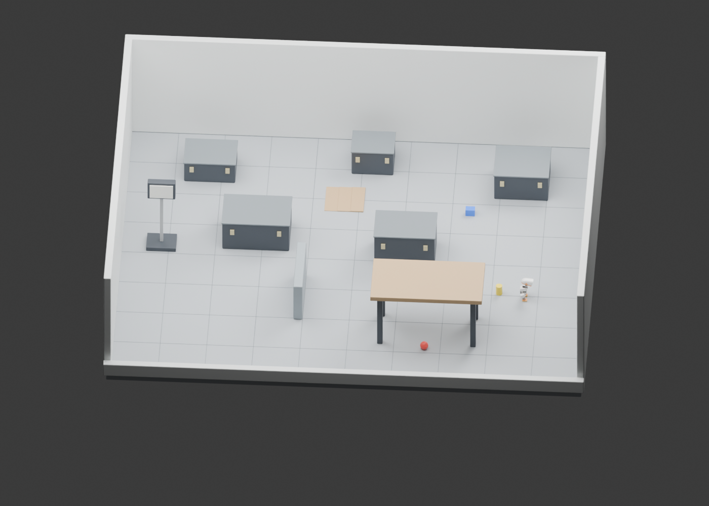
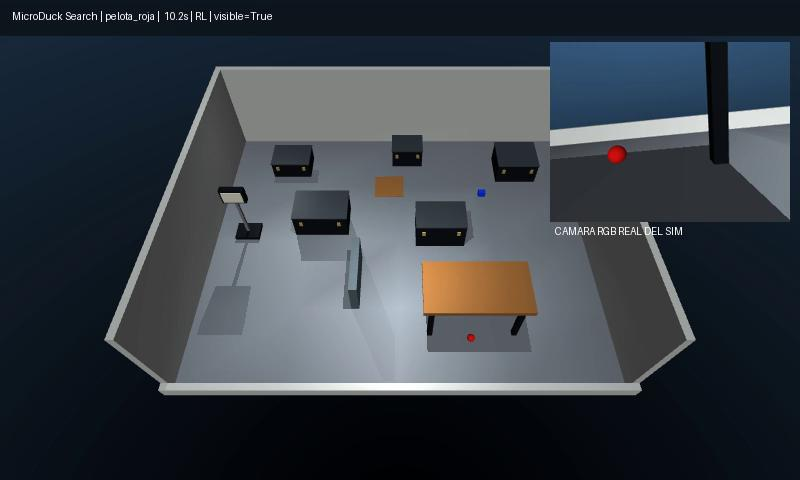

# MicroDuck Room Search

**A reproducible simulation project: train a search supervisor with PPO, then run it on a free-floating MicroDuck in a furnished MuJoCo room.**

[GitHub · Bravo Robots](https://github.com/Bravo-Robots/microduck-room-search) · [GitHub · David](https://github.com/david2526IA/microduck-room-search) · [Hugging Face · models and assets](https://huggingface.co/BravoRobots/microduck-room-search)



[Guía en español](docs/GUIA_ES.md) · [Model card](outputs/release/MODEL_CARD.md) · [Measured results](outputs/release/RESULTS.json) · [Contributing](CONTRIBUTING.md)

Version **0.2.1** is a simulation research release. It searches for three specified
objects: a red ball, a blue box and a yellow cylinder. It does not yet recognize
arbitrary household objects or run autonomously on a physical MicroDuck.

## Quick start

Supported: Linux x86-64, Python 3.12, OpenGL and [uv](https://docs.astral.sh/uv/).
The trained demo works on CPU; a CUDA GPU accelerates training. Installation uses
the checked-in lockfile and initially downloads several GB of PyTorch dependencies.

From the checkout root:

```bash
uv sync --locked
bash run.sh doctor
bash run.sh rehearse --viewer --no-video
```

To record a headless run, or search for another object:

```bash
bash run.sh rehearse --goal 1 --seed 3 --video outputs/blue-box.mp4 \
  --output outputs/blue-box.json
```

Goals: `0` red ball, `1` blue box, `2` yellow cylinder. The default budget is
108 simulated seconds. The JSON report distinguishes success, timeout, fall,
false confirmation and an interactively closed viewer. Output directories are
created automatically.

For headless GPU rendering, `run.sh` defaults to `MUJOCO_GL=egl`. On a CPU-only
Linux machine install `libosmesa6` and use `MUJOCO_GL=osmesa bash run.sh preview`.
The interactive viewer requires a desktop session. See [troubleshooting](docs/TROUBLESHOOTING.md).

## What is included

| Component | Location |
|---|---|
| Editable room and robot scene | [Blender file](assets/workshop_search.blend) |
| Original workshop props, metres | [17 STL files](assets/stl) |
| Seeded layout and physical scene generator | [scene.py](duck_search/scene.py) |
| GPU-vectorized search environment | [env.py](duck_search/env.py) |
| PPO trainer and trained supervisor | [ppo.py](duck_search/ppo.py), [release](outputs/release) |
| Actual MuJoCo body, BAM motors, RGB detector | [physical.py](duck_search/physical.py) |
| Depth-only braking layer | [guard.py](duck_search/guard.py) |
| Reports including individual failures | [benchmarks](benchmarks) |
| Locked dependencies and automated checks | [uv.lock](uv.lock), [CI](.github/workflows/ci.yml) |

The room, model files and motor policies are bundled. No neighbouring workshop
checkout, account, token, model API or cloud subscription is needed to run it.

## Recorded demo

[](docs/media/demo.mp4)

[Watch the 10.2-second rollout](docs/media/demo.mp4) · [Exact episode report](benchmarks/v0.2/demo.json).
Seed 0, goal 0: success, no fall, no furniture contact. This single demo does not
replace the fixed-seed evaluation below.

## Architecture and scope

The new policy is a **45-input → 6-action search supervisor**, not a motor policy.
It learns in a fast planar SE(2) proxy with occlusion, object visibility, obstacle
footprints and visitation memory. It is then evaluated on the actual articulated
robot in MuJoCo with contacts, BAM M6 actuators and motor ONNX policies at 50 Hz.
The supervisor has not been fine-tuned inside the complete rigid-body dynamics.

The actor receives forward depth, the requested object's visible detection,
last-seen memory, visit memory, odometry and its previous action. It never receives
the hidden object's coordinates. Full-body perception uses rendered RGB and
synthetic depth. Segmentation and target ground truth are reserved for diagnostics
and the independent evaluator.

A depth-only guard checks the forward corridor at 10 Hz. It can replace an unsafe
advance with a turn. Both RL and reactive benchmark controllers use this same
guard. Full-body success therefore describes the **RL + guard + motor policies**
system, rather than RL alone.

Locomotion reuses the workshop-trained `progresion_4_mejor.onnx` gait and Pollen's
`velstand.onnx`/`alpha_stand.onnx`. The local gait is identified as such; it is not
presented as an official Pollen checkpoint or as newly trained by this project.
See the [model contract](outputs/release/MODEL_CARD.md).

## Evaluation

Version 0.2.1 keeps the trained weights and runtime unchanged from 0.2.0;
its changes concern integration testing and publication. Benchmark measurements
remain the recorded 0.2.0 runs.

Current measurements, checkpoint hashes, seeds, contacts, falls and false
confirmations are in [RESULTS.json](outputs/release/RESULTS.json).

<!-- RESULTS:BEGIN -->
| Evaluation | Success | Falls | False confirmations | Episodes with furniture contact |
|---|---:|---:|---:|---:|
| PPO supervisor + guard, MuJoCo body | 49/60 (81.7%) | 9 | 0 | 4 |
| Reactive controller + same guard | 28/60 (46.7%) | 0 | 0 | 3 |
| PPO, planar training proxy | 237/256 (92.6%) | n/a | n/a | n/a |

The physical supervisor was trained for 11,993,088 proxy transitions; the selected
checkpoint is from transition 10,444,800. Proxy collision-attempt rate is 35.2%
of active steps and must not be interpreted as the full-body contact rate.
<!-- RESULTS:END -->

The full-body suite uses seeds 10–29 and all three goal classes. Validation selects
the checkpoint on a different proxy seed; final proxy evaluation uses seed 3030.
Furniture positions and object locations vary within one room-layout family.
Detector thresholds were adjusted after examining failures in this full-body
suite, so it is a regression benchmark, not an untouched test set. These results
do not establish generalization to other floorplans or hardware.
Version 0.1 measurements are retained as [historical results](benchmarks/v0.1).

```bash
bash run.sh evaluate outputs/release/best.pt --seed 3030 --episodes 256
bash run.sh benchmark --seeds 20 --start-seed 10 --controller rl \
  --output outputs/my-rl-suite
bash run.sh benchmark --seeds 20 --start-seed 10 --controller baseline \
  --output outputs/my-baseline-suite
```

A positive full-body result requires an actor confirmation at estimated camera
range below 0.55 m, independently verified target pixels, and trunk-to-target
centre distance below 0.75 m. These thresholds account for camera offset and
object radius. The evaluator's ground truth is never fed to the actor.

## Train or resume

```bash
# Short CPU smoke test: environment, PPO update, evaluation and ONNX export.
bash run.sh train --device cpu --steps 1536 --envs 8 --output outputs/my-smoke

# Main training recipe. Use a fresh directory for every run.
bash run.sh train --steps 12000000 --envs 256 --seed 42 \
  --output outputs/runs/my-search

# Warm-start weights and optimizer; the transition counter is preserved.
bash run.sh train --resume outputs/release/best.pt --steps 3000000 \
  --output outputs/runs/my-continuation

# Test the resulting supervisor on the physical simulated body.
bash run.sh rehearse --checkpoint outputs/runs/my-search/best.pt \
  --goal 0 --seed 0 --no-video
```

Resume starts a new scene/curriculum stream; it is a warm start, not a bitwise
continuation of environment and RNG state. The requested transition budget is
rounded down to complete 96-step rollout batches, with a minimum of one batch.
Existing checkpoint directories are rejected to prevent accidental overwrite.

## Edit the environment

`duck_search/scene.py` generates `assets/room.json` and a local MJCF. Runtime
include paths are regenerated after moving or extracting the checkout.

```bash
bash run.sh build --seed 0
bash run.sh preview
```

The preview creates overview, RGB, depth and segmentation images in `outputs/`,
plus compiled robot meshes for Blender regeneration. To regenerate the editable
scene and STL props use the separate Blender Python environment:

```bash
uv venv .blender-venv311 --python 3.11
uv pip install --python .blender-venv311/bin/python bpy==4.5.15
.blender-venv311/bin/python -m duck_search blender
```

The `.blend` is an authoring scene; robot dynamics execute in MuJoCo. STL units are
metres: scale by 1000 when importing into a millimetre-based slicer. These are
geometry prototypes, not structurally validated printable assemblies.

## Development and publication

```bash
uv run ruff check duck_search scripts tests
uv run ruff format --check duck_search scripts tests
uv run python -m unittest discover -s tests -v
uv run python scripts/check_repo.py
uv run python scripts/package_release.py
```

The public ZIP contains code, assets, trained models, reports, provenance and a
SHA-256 file manifest. It excludes environments, caches, temporary experiments
and third-party video-reference captures. The source archive is checked from a
separate directory before delivery. CI runs on CPU-only Ubuntu and checks
installation, tests, short training,
rendering and a full-body integration mission in an unobstructed aisle.
The integration test requires RGB detection, motor-driven approach, a verified
confirmation, no fall and no contact. Search performance in clutter is evaluated
separately in the fixed-seed benchmark. Check the latest run on
[Bravo Robots](https://github.com/Bravo-Robots/microduck-room-search/actions)
or the [personal mirror](https://github.com/david2526IA/microduck-room-search/actions).

The Hugging Face model repository contains the same code, room assets and frozen
release weights, with model-card metadata. Its `v0.2.1` tag pins this release.
To validate or publish a future model update using your own authenticated account:

```bash
uv run python scripts/publish_huggingface.py --repo-id OWNER/microduck-room-search
uv run --with huggingface-hub python scripts/publish_huggingface.py \
  --repo-id OWNER/microduck-room-search --publish
```

## Known limits

- Odometry is ideal simulator pose; planar depth rays are idealized.
- Floating-point and rendering differences can change trajectories across hosts;
  matching seeds do not guarantee bitwise identical full-body rollouts.
- Detection uses three colour classes, not an open-vocabulary vision model.
- Full-body episodes can still fail or make contact with furniture; inspect the reports.
- Camera intrinsics, delay, calibration and recovery need hardware validation.
- Motor policies use the separate **61 → 14** contract. Do not load the search
  ONNX directly with `robotctl policy load`.

## Attribution and licences

Original code and workshop prop geometry: Apache-2.0. Pollen robot meshes and
mesh-containing derivatives, including the `.blend`, are **CC BY-NC-SA 4.0**.
This is a mixed-licence repository, not a blanket commercial-use grant for assets.
See [THIRD_PARTY.md](THIRD_PARTY.md) and the [original model licence](third_party/robot/LICENSE-MODELS.md).

Visual workflow inspiration: [the supplied video](https://www.youtube.com/watch?v=ac6pspFbPsI&t=353s)
and [NVIDIA's MicroDuck tutorial](https://huggingface.co/blog/nvidia/microduck-isaac-lab-sim-to-real).
This implementation uses MuJoCo and Blender; it does not reproduce the video's
Isaac Sim/Newton/Omniverse stack. Reference-video captures remain local.
